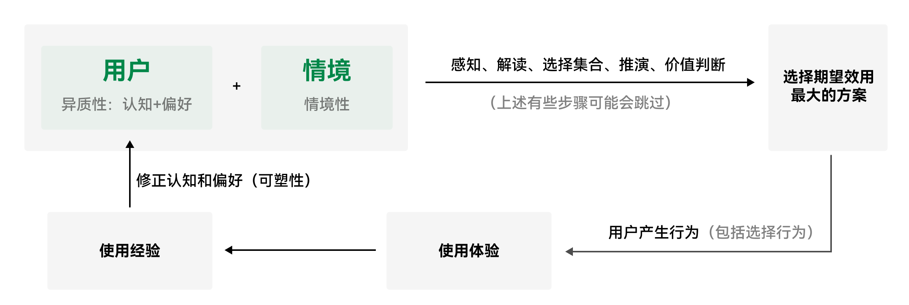

# 如何理解用户？

## 目录

- [一、用户的定义](#一用户的定义)
- [二、如何理解用户的行为](#二如何理解用户的行为)
- [三、如何理解用户价值](#三如何理解用户价值)

本文是在产品经理的视角下来理解用户，产品经理的核心工作是研究用户，使企业面向用户需求来研发产品，如果不面向需求来研发产品，那么产品很快会因为缺少市场而卖不出去，从而导致资源浪费。因此本文将着重阐释用户的定义以及研究用户行为背后的原理进一步去理解用户。

---

## 一、用户的定义

> [!IMPORTANT]
> 💡 用户不是自然人，而是需求的集合

> 假如一个 App 有 1000 万注册用户，但当前产品核心能力只稳定满足其中 100 万人在特定场景下的某类需求，那么在研究这一需求对应的产品用户时，真正需要重点分析的是这 100 万人，而不能简单地把全部 1000 万注册用户视为同一类用户。

---

**需求又可以大致分为C端需求、B端需求和G端需求**

用户虽然是需求的集合，但是给用户抽象化的过程也会丢失一些需求细节，这时候需要听取和参考一些具体的用户反馈，这里可能会用到一些用户研究方法，比如问卷，但是问卷调研也有比较明显的弊端，一些积极用户填写的反馈可能更丰富和真实，但是一些本身就比较消极的用户可能不能完整的反馈其需求，所以需要多元化的用户研究方法来整理需求。这里一定要基于事实去做调查，而不是基于幻想，偏见。

用户在情境的刺激下激活了某些偏好与认知→对某个产品有了感知与解读→形成选择列表→经过有限理性下的模拟推演，做出自利性的价值判断→做出交易行为→行为效果反过来修正主观的认知与偏好→影响下一次交易行为的发生（可塑性）

---

### 1.用户的五个属性

> [!IMPORTANT]
> 💡 异质性、情境性、可塑性、自利性、有限理性

- **异质性：** 指用户特点千差万别，几乎很难找到两个完全一样的用户。因为用户的偏好、认知、所拥有的的资源是不一样的，所以不能把用户统一成一个单一的用户画像。
- **情境性：** 指用户的行为受环境的影响，没有情景就没有用户，同一个用户在不同的环境下会有不同的反应和行为。
- **可塑性：** 指用户是可变的，其偏好和认知会随着外界的不同信息刺激发生变化和演化，具备可塑性。
- **自利性：** 指用户追求个人总效用最大化。
- **有限理性：** 指用户虽然追求理性，但他的能力是有限的，其判断经常出错，也经常被骗，所以只能做到有限的程度。

---

## 二、如何理解用户的行为

在行为发生前，用户通常会接受一个情境的刺激，这个情境的刺激会调用偏好和认知函数（感知、解读、选择集合、推演、价值判断），产生一个主观期望效用，促使用户产生相应的行为，即追逐这个预期的效用。而行为会产生某个结果,这个结果又会成为经验,影响偏好和认知函数，从而可能对用户的下一次行为产生影响。

情境刺激会激发人的感知、解读、选择集合、模拟推演、价值判断 ；在产品研究的范围内，我们可以把用户理解为一种“偏好和认知函数”，通过计算得出期望效用最大的值，然后产生用户行为和行为体验，行为体验进一步形成经验，最后又会塑造用户的偏好和认知。

---

### 如何促成用户行为？

作为产品经理，我们需要思考如何让用户选择我们的产品。根据用户行为模型，可以得知，影响用户行为的核心因素包括：**用户自身的认知与偏好、所处情境，以及用户对不同选择所形成的期望效用。**

> [!IMPORTANT]
> 💡 最有效的方法是：选择合适的人，在合适的情境下，让目标行为成为用户眼中期望效用最高的选择。

优先找到那些**认知和偏好本身就与产品价值相匹配的人群** 。对于这类用户，不需要设计过多复杂的刺激或说服机制，只要在合适的情境下出现，产品本身就更容易成为其“期望效用最大”的选择，从而促成行为。

如果目标用户与产品并不天然匹配，就需要进一步通过**情境设计** 来影响用户的感知、解读、选择集合、推演和价值判断，使用户对目标行为形成更高的期望效用，最终促成交易、使用等行为。

> 情境设计：通过改变用户当下看到的信息、选项和环境条件，影响其感知、判断和价值评估，使目标行为成为更高期望效用的选择。

**促成用户行为的优先级：**

1. **选对用户** ：选择认知和偏好与产品匹配的人群；
2. **选对情境** ：在用户需求更强、目标行为更有价值的情境下出现；
3. **设计决策过程** ：通过信息呈现、选项设置、默认项、反馈、价格、激励等方式影响用户判断；
4. **提高目标行为的期望效用** ：让用户觉得“选择这个产品最值得”；
5. **用实际体验强化认知和偏好** ：好的体验会形成经验，进一步提高未来再次选择的概率。

---

## 三、如何理解用户价值

> [!IMPORTANT]
> 💡 对用户来说，价值由主观效用决定

> 价值最早的定义出现于经济学萌芽期，指无差别的人类劳动。价值是劳动决定的，这本质上是成本价值论或客:观价值论。经过从19世纪70年代持续到20世纪初的边际革命，人们认识到边际效用的概念，认为价值是由效用决:定的，国际学术界和社会开始普遍接受价值的主观性，放弃了价值的客观性。

产品本身具有客观属性，但这些属性并不直接等于用户价值。真正决定用户是否觉得“有价值”的，是用户在特定情境下，对这些属性所产生的**主观效用评价。**

**用户价值 ≠ 产品客观属性本身**

**用户价值 = 用户在特定情境下感知到的效用**

---

### **什么是效用？**

> [!IMPORTANT]
> 💡 效用是欲望的满足程度，人通过消费物品和劳务满足欲望

用户通过商品、服务或某种行为来满足自己的欲望。不同选择能够满足用户欲望的程度不同，因此会产生不同效用。

- 苹果手机的操作系统，审美，其实也是一种主观价值，有的人愿意花费大价钱购买，有的人觉得不值，只是他们的主观价值不同罢了；
- 饿的时候，一顿饭的效用很高；
- 吃饱以后，同样一顿饭的效用会显著下降；
- 喜欢橘子的人，会认为橘子的效用高于苹果；
- 但连续吃很多橘子以后，后续橘子的边际效用会降低。

---

### 效用的特点

#### 1.主观性

效用不是物品天然具有的，而是**用户对物品效果的主观判断** 。同一个产品，对不同用户的效用可能完全不同。

> 例如：普通人买明星代言产品，可能只获得产品本身的使用价值；而粉丝购买同样的产品，还可能获得情感认同、身份表达等额外效用。因此，同一个产品在不同用户眼中，价值可能完全不同。

#### 2.情境性

同一个人，在不同情境下，对同一个产品的效用判断也会变化。

> 比如一瓶水：平时可能只值 2 元；沙漠中极度口渴时，对用户来说可能具有极高价值。

> 这说明：**用户价值不是固定的，而是“用户 × 情境”共同决定的。**

#### 3.边际效用递减

当同一种欲望被持续满足时，继续增加同类商品所带来的效用通常会下降。

> 第一个橘子很好吃，第二个还不错，但连续吃到第十个时，新增的满足感已经很低。所以用户价值不是简单地“越多越好”，而与用户当前需求被满足到什么程度有关。

---

### 用户价值公式

> [!IMPORTANT]
> 💡 用户价值=新体验-旧体验-替换成本

这个公式在这里不赘述，从这个维度，提升用户价值有三种方式:让新体验最大化，让旧体验最小化，降低替换成本，三者互相影响。要让用户价值最大化，必须综合权衡三者，总是在当前约束条下进行资源最优配置。

---

### 相对价格

用户做选择时，不只看价值高不高，还会比较为了获得这些效用，我总共要付出多少成本。

用一个公式可以表示为：

> [!IMPORTANT]
> 💡 相对价格 =（直接成本 + 交易成本）÷ 效用组合

其中：

- **直接成本** ：用户直接支付的钱，比如商品价格、服务费、会员费；
- **交易成本** ：为了完成这次交易额外付出的时间、精力、学习成本、搜索成本、决策成本、等待成本、风险成本等；
- **效用组合** ：用户从产品中获得的各种效用之和，比如功能效用、情绪价值、身份价值、便利性、安全感等。

（相对价格越低，用户越容易觉得“值得”；相对价格越高，用户越容易放弃。）

> 例如：打车费用是 50 元，公交只要 3 元。如果只看直接成本，公交明显更便宜；但如果用户赶时间，那么公交还包含等待、换乘、步行和迟到风险等交易成本。此时打车虽然贵，但由于节省时间、减少麻烦、降低迟到风险，效用组合更高，用户反而可能认为它“更划算”。

---
