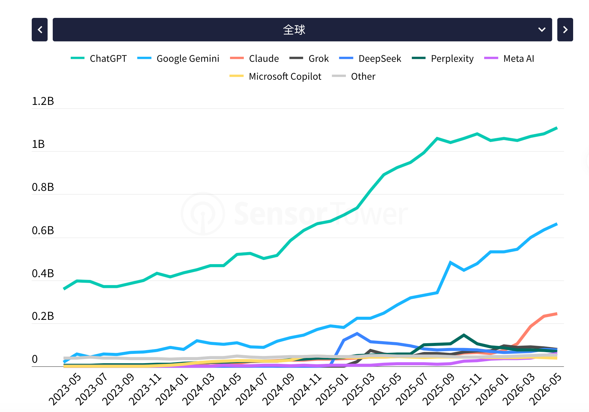
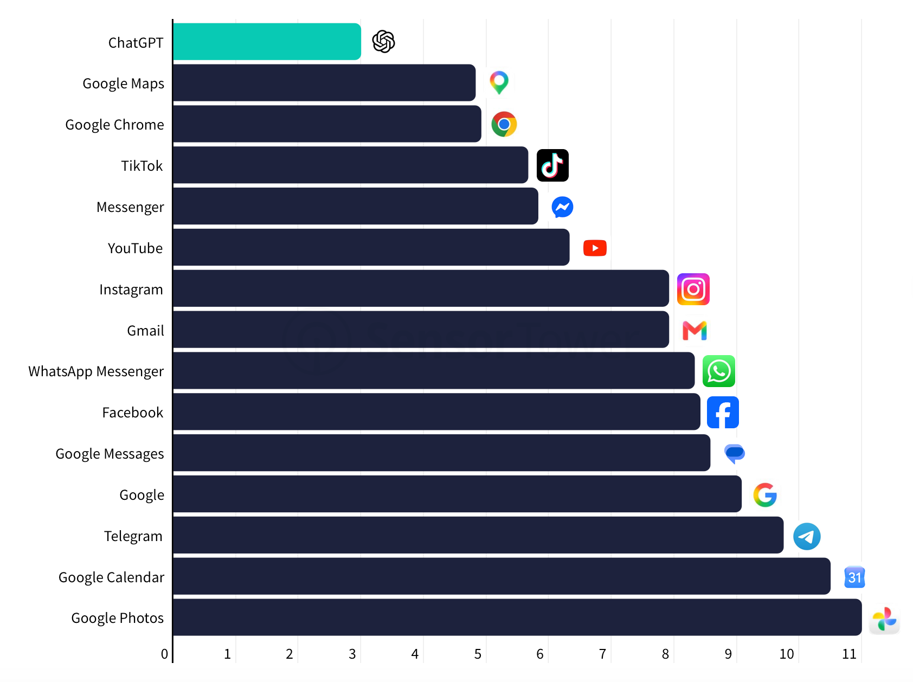
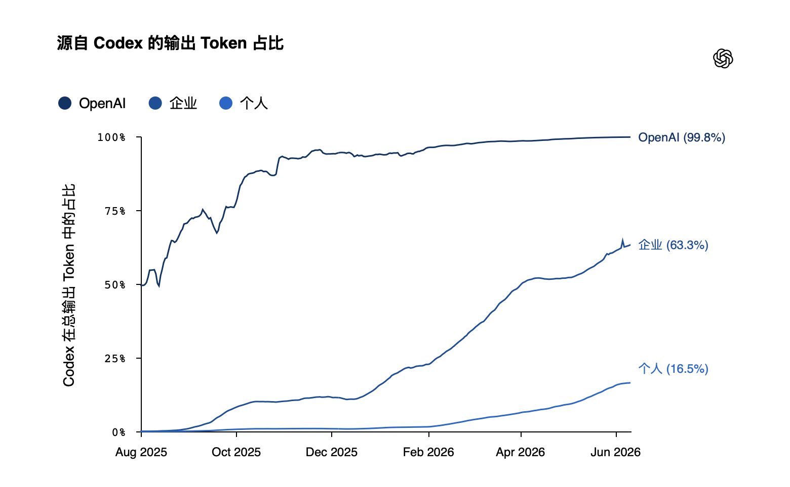
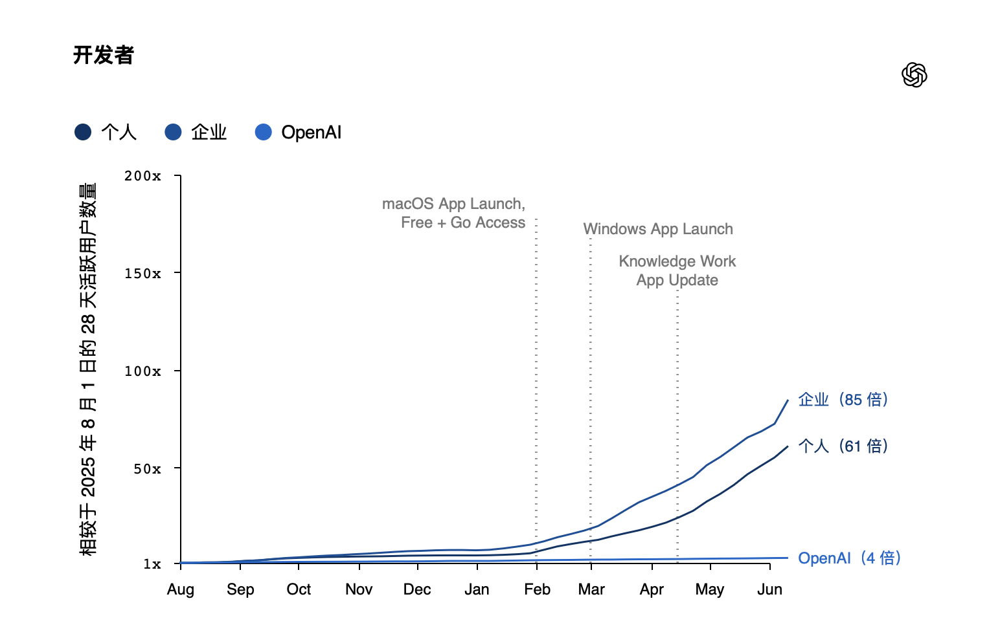
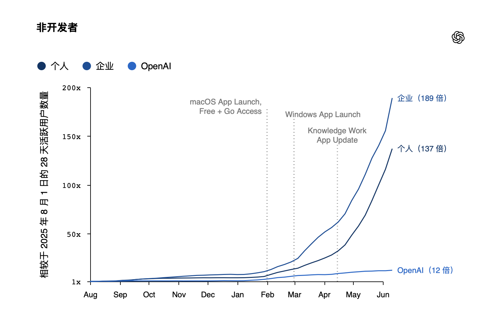
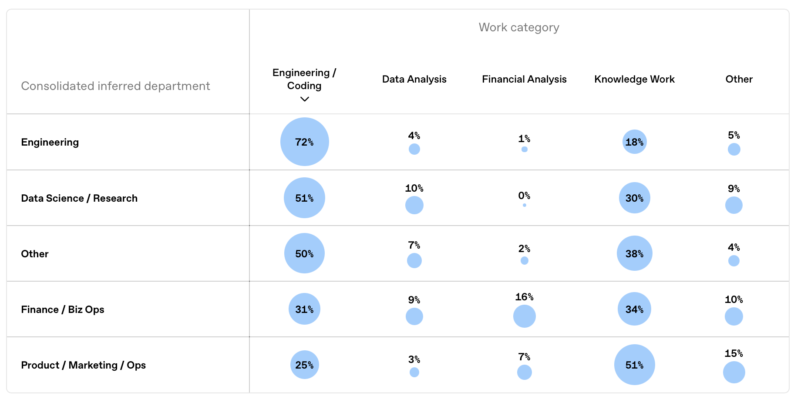
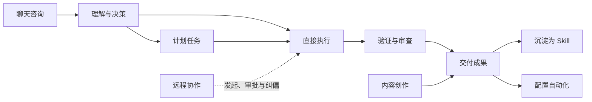
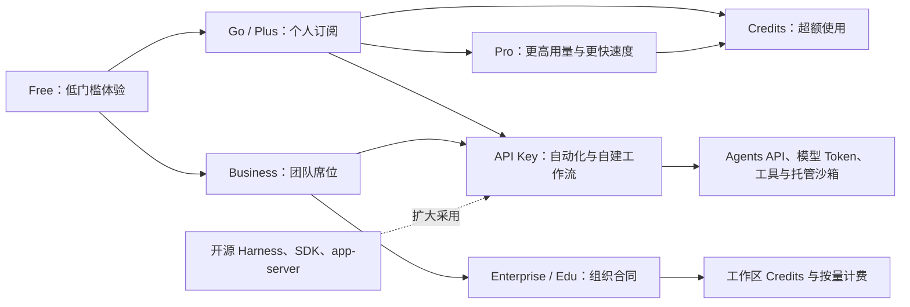
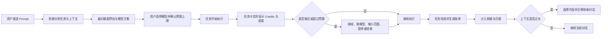

# OpenAI Codex 产品拆解

> 体验与分析：Pi-Design  
> 体验时间：2026 年 7 月—10 月  
> 最后更新：2026 年 10 月 12 日

[返回 AI 产品经理学习笔记首页](../../README.md)

---

# 一、体验环境和分析方法

1. 产品名称：Codex
2. 产品类型：Agentic Coding and Work Platform
3. 体验时间：2026.7-2026.10
4. 体验人：Pi-Design
5. 核心方法论：
    
    结合《俞军产品方法论》中的用户价值公式、相对价值公式进行分析；
    
6. 本文利用Codex辅助我完成这篇报告：
    1. 我负责的内容：全文框架搭建及初版文字撰写、行业报告调研、文献调研
    2. Codex负责内容：文字润色、Codex相关调研

---

# 二、产品概述

## 1.Codex 的发展历程

| 时间 | 重要节点 | 意义 |
| --- | --- | --- |
| **2025 年 5 月 16 日** | [云端 Codex 以研究预览形式发布](https://openai.com/index/introducing-codex/)，用户可把功能开发、修复问题等任务交给独立的云端环境执行，并审查结果。
仅向ChatGPT Pro、Team 和 Enterprise 用户开放使用。 | 基于GPT模型的云端软件工程智能体，让GPT模型拥有了动手干活的能力。 |
| **2025年5月19日** | 在IOS系统上发布Codex移动版 | 当用户离开Desk时，也能支持从移动端发起和管理云端编程任务。 |
| **2025 年 6 月 3 日** | [开放给 ChatGPT Plus 用户](https://openai.com/index/introducing-codex/)；用户也可为任务配置互联网访问。 | 扩大使用范围，并提高云端任务处理真实项目的能力。 |
| **2025 年 8 月 27 日** | [推出 IDE 扩展、本地与云端任务衔接、代码审查](https://learn.chatgpt.com/docs/changelog)。 | Codex 融入开发流程。 |
| **2025 年 9 月 23 日** | [**GPT-5-Codex 开放 Responses API](https://learn.chatgpt.com/docs/changelog)，也可通过 API Key 在 Codex CLI 中使用。** | 开发者能够通过 API 调用用于 Codex 的编程模型，将其接入自己的工具和流程。 |
| **2025 年 10 月 6 日** | [Codex 正式全面开放](https://openai.com/index/codex-now-generally-available/)，同时推出 Slack 集成、Codex SDK 和团队管理功能。 | 进一步利好开发团队进行应用和工作流开发。 |
| **2026 年 2 月 2 日** | [Codex 桌面应用在 macOS 发布](https://openai.com/index/introducing-the-codex-app/)，支持集中管理多个并行任务、审查修改，以及使用技能和自动化；**3 月 4 日**扩展到 Windows。 | Codex实现了MAC OS系统和Win系统的终端部署。 |
| **2026 年 3 月 25 日** | [插件功能上线](https://learn.chatgpt.com/docs/changelog)，可将技能、应用集成等组合为可复用的工作流。 | Codex 增强了自己能力扩展的接口 |
| **2026 年 4 月 16 日** | [桌面应用加入浏览器预览、电脑操作、无需先选代码项目的聊天，以及文档等成果的预览](https://learn.chatgpt.com/docs/changelog)。 | 工作对象从代码库扩展到网页、桌面应用和其他交付成果。 |
| **2026 年 5 月 14 日** | [通过 ChatGPT 手机应用连接运行 Codex 的电脑](https://learn.chatgpt.com/docs/changelog)，可从手机跟进同一工作环境中的任务。 | 手机连接正在运行 Codex 的 Mac，访问同一台电脑里的项目、文件、凭据、技能和配置 |
| **2026 年 6 月 2 日** | [推出面向不同岗位的插件、Sites 和批注能力](https://openai.com/index/codex-for-every-role-tool-workflow/)。 | Codex 明确从软件开发扩展到分析、设计、营销等知识工作。 |
| **2026 年 8 月 19 日** | OpenAI 开放 Codex 智能体运行框架，并提供 `codex exec`、Codex SDK 和 app-server 等集成层，推动 Codex 从独立智能体产品发展为可嵌入第三方产品和业务流程的平台。 | 让开发者可以把 Codex 嵌入自己的产品和工作流程。 |

## 2.产品定位

为实际工程或工作流打造端到端的开发支持

关键词：编程开发、多智能体工作流、多端（云端、PC端、移动端）智能体助手

---

# 三、用户分析

> Codex在2025年4月份发布时，最初是为了软件开发而设计的，然而随着Codex的能力不断发展，其在解决日常办公、创意设计、知识搜索等非开发领域的应用等能力也不断增强，越来越多的非开发者也开始使用Codex。
> 

## 1.目标用户

### a.开发者和技术人员

#### **主要任务**

编写与审查代码、调试、测试、管理仓库、配置环境、部署应用…

#### **用户需求**

1. 端到端完成开发任务
    
    连续完成**代码编写、调试、修改、测试、更新和提交**，减少开发者在多个工具之间的切换。
    
2. 理解完整项目上下文
    
    开发项目的上下文类型多样，包括图片、代码、文档、依赖关系、技术规范和团队约束等等。
    
3. 融入现有的开发环境
    
    与IDE、终端GitHub、代码仓库、CI/CD和项目管理工具连接起来。
    
4. 帮助学习和提升技能
    
    面对用户不熟悉的领域或者项目，能够快速解释代码架构，帮助开发者快速理解陌生项目。
    

> Stack Overflow 2026调查显示，开发者委托AI最多的任务是编写代码（72.9%）、调试（62.2%）、测试（50.6%）、文档（48.3%）和代码审查（44.9%）。开发者更换AI工具的首要原因也是输出质量，其次才是工作流集成和价格。[Stack Overflow 2026开发者调查](https://survey.stackoverflow.co/2026/knowledge/data)
> 

### b.企业工作者

#### **主要任务**

分析数据、制作文档、研究信息、处理表格、构建内部工具、自动化流程…

#### 用户需求

1. **直接处理真实工作资料**
    
    能够读取表格、文档、邮件、会议记录和内部知识库，并理解这些资料之间的关系，避免用户手动复制粘贴。
    
2. **快速产出可交付成果**
    
    直接生成报告、PPT、数据分析、合同、研究材料、图片表格和业务方案。
    
3. **减少重复性流程**
    
    把数据整理、周报制作、资料收集、格式转换和状态同步等重复任务变成可持续运行的工作流。
    
4. **降低技术门槛**
    
    不会编程的员工也能通过自然语言制作内部工具、分析数据或实现自动化，减少排队等待工程团队支持的时间。
    
5. **能够连接企业现有软件**
    
    从飞书、钉钉、Slack、Notion、Google Drive、SharePoint等系统获取信息，并把结果写回员工日常使用的软件。
    
6. **结果容易编辑和审查**
    
    用户需要知道信息来源、计算过程和修改内容，并能够直接批注、调整和要求返工。
    
7. **跨工具推进完整流程**
    
    通过调用不同工具完成信息收集、内容制作、团队审查和审批等多个步骤。
    
8. **满足企业安全与合规要求**
    
    遵守数据权限、身份认证、保密规则和审计要求，防止员工或智能体访问无权查看的信息。
    
9. **总结SOP**
    
    将组织规范、模板和操作流程制作成可共享的Skill，让不同员工获得相对一致的结果。
    

### c.个人用户

#### **主要任务**

个人项目、学习、财务分析、资料整理和兴趣任务

#### 用户需求

1. **开箱即用、操作简单**
    
    不需要配置复杂环境或掌握编程，通过自然语言说明目标即可开始执行。
    
2. **完成个人项目**
    
    帮助用户制作网站、小程序、自动化脚本、数据看板和兴趣项目，将“我有一个想法”转化为可以使用的成果。
    
3. **辅助学习并解释过程**
    
    在提供答案之外，解释操作步骤、代码和错误原因，让用户能够理解并继续修改。
    
4. **整理个人资料**
    
    处理文件、学习资料、消费记录和个人数据，完成归档、分类、总结和分析。
    
5. **处理较长的复杂任务**
    
    用户可以把任务交给Codex后台执行，不必一直守在对话窗口逐步指导。
    
6. **价格透明且可控制**
    
    清楚了解订阅、额度和任务成本，避免长时间运行后产生无法预期的费用。
    
7. **保护个人隐私**
    
    明确哪些文件会被读取、哪些信息可能上传，并允许用户控制文件、网络和应用权限。
    
8. **提供安全感和纠错能力**
    
    在删除文件、修改重要资料或进行财务操作前要求确认，并支持查看记录、撤销修改和恢复文件。
    

## 2.用户规模

### a.**ChatGPT 保持最大的用户覆盖规模**

ChatGPT 仍保持最大的真实用户规模，但近几个月多款竞争产品持续缩小差距。Google Gemini 依托庞大的 Android 用户基础以及 Google 生态的深度整合，真实用户规模稳步增长；与此同时，Claude 自2026年初以来也保持了较快的增长势头。

### **b.ChatGPT 成为最快突破10亿月活跃用户的移动应用**

ChatGPT 自2023年上线以来，仅用三年时间便于2026年5月突破10亿月活跃用户（MAU），成为最快达到这一里程碑的移动应用。

AI 正以极快速度进入大众市场，吸引了来自不同地区和各年龄层的移动用户。

## 3.关键数据分析

### 群体渗透程度

由图可知，除Open AI 以外的企业在2026年6月份，有63.3%的员工和16.3%的个人用户在过去一个月内有使用至少一次Codex，由此可见，Codex在企业中的渗透率是极高的，然而在更广大的个人用户群体中的渗透率较低，我认为可能有以下原因：

1.Codex对中国、俄罗斯等国家和地区存在服务限制；

2.市面上的智能体工作平台种类繁多，Cursor、Trae、豆包、Claude Code等

### **非开发者是增长最快的用户群体**

纵观所有用户群体（OpenAI 内部用户、企业用户以及个人用户），Codex 的应用最初都始于开发者 — 作为一款以编程工具起步的产品，这是其天然的目标受众。然而，随着 Codex 向更广泛的知识型工作领域拓展，它在非开发者群体中的普及速度甚至更快。如下方的用户增长图表所示，在个人、企业及 OpenAI 内部群体中，每周活跃的非开发者用户增速均超过了开发者用户。到 2026 年 6 月初，非开发者个人用户的数量达到了 2025 年 8 月的 137 倍；非开发者企业用户增长了 189 倍；而 OpenAI 内部的非开发者用户则增长了 12 倍（这大概是因为该内部群体的基数起点已远高于平均水平）。

这一转变并不意味着每个非开发者都在以工程师的方式使用 Codex。相反，它意味着越来越多的非开发者正在运用 Codex 执行某些形式的智能体辅助工作。

### **Codex 正在拓宽潜在生产力工作的边界**

Codex 使非技术部门能够加速那些过去因缺乏技术专长而受阻的工作流程。下方的热力图对比了 OpenAI 内部的推断职位与 Codex 输出结果中所代表的工作类型。在数据科学与研究领域，工程与编程是占比最大的类别；而在财务、业务运营、市场营销、常规运营及其他部门中，知识型工作则占据了最大比例。

也就是说，智能体工具能够拓宽个体员工的工作能力边界。例如，在商业职能部门员工使用 Codex 完成的工作中，超过四分之一属于工程或编程范畴。智能体能够降低跨越任务边界的成本，协助员工完成过去需要更加专业的技术支持才能应对的相邻领域工作。

### **这对智能体的经济潜力意味着什么？**

非工程师员工越来越多地使用智能体工具，拓展了这些员工的工作能力边界。这对于决定如何重构工作流程的企业、对于正在评估哪些技能将变得更具价值的员工，以及对于试图了解 AI 将如何改变劳动力市场的政策制定者和研究人员而言，都具有重要意义。

当人们能够以广泛且低门槛的方式接触到强大的智能体工具时会发生什么：随着工具的不断演进，人们会将其应用于周期更长、更加复杂且更具跨职能属性的工作中。这极有可能成为未来工作模式的真实写照。

---

# 三、Codex产品架构

- 
    1. 产品定位与价值
    - 面向软件开发与知识工作的智能体产品
    - 从“回答问题”升级为“理解任务并完成交付”
    - 核心闭环：理解意图 → 获取上下文 → 规划 → 执行 → 验证 → 审阅与交付
- 
    1. 产品入口与形态
    - Codex App：桌面端的任务编排、并行工作、审阅与交付中心
    - Codex CLI：终端优先，适合本地开发与脚本化任务
    - IDE 扩展：贴近代码编辑器的上下文协作
    - Codex Cloud：托管环境中的异步、远程执行
    - Remote：移动端查看、引导与管理远程任务
    - 嵌入式能力
        - codex exec：一次性、非交互任务
        - Codex SDK：应用内启动、恢复和流式处理任务
        - Codex app-server：持久会话、事件流、工具与审批生命周期
        - Agents API：OpenAI 托管的 Codex 智能体运行时
- 
    1. 核心智能体层（Codex Harness）
    - 模型：推理、代码生成、分析与多模态理解
    - 任务循环：理解 → 计划 → 调用工具 → 观察结果 → 修正 → 完成
    - 会话状态：线程、轮次、事件、恢复与中断
    - 上下文管理：项目结构、文件、差异、命令结果、历史压缩
    - 编排：长任务、并行任务、子智能体与失败恢复
    - 进度反馈：实时输出、阶段状态、结果摘要
- 
    1. 上下文与指令体系
    - 用户提示：当前目标、约束和验收标准
    - 项目上下文：仓库、文件树、代码、文档与运行结果
    - AGENTS.md：团队级、仓库级的持久规范
    - 配置：全局与项目级 config.toml
    - 附件：图片、文件、截图及其他任务材料
    - 记忆与会话压缩：跨轮保留关键工作状态
- 
    1. 工具与执行环境
    - 文件工具：读取、搜索、编辑与生成制品
    - 终端工具：运行命令、构建、测试与诊断
    - Git 与评审：分支、差异、提交、PR、行级评论
    - 浏览器与 Computer Use：网页验证和桌面应用操作
    - Web：获取最新公共信息并附带来源
    - MCP 与应用连接器：访问外部数据和受控动作
    - 执行位置
        - 本地当前工作区
        - 隔离 Worktree
        - 沙箱环境
        - OpenAI 托管云环境
- 
    1. 扩展生态
    - Skills：可复用的专业工作流、说明与资源
    - Plugins：打包 Skills、工具、MCP、应用与资产
    - MCP Servers：连接业务系统、数据源与动作
    - Apps / Connectors：授权访问第三方工作平台
    - Hooks：在生命周期与工具调用前后执行规则
    - Automations：定时检查、提醒、监控与后台任务
- 
    1. 协作与工作管理
    - Thread / Chat：一项持续工作的上下文容器
    - Plan Mode：先澄清和设计，再进入实施
    - Goals：长期目标、预算与完成状态
    - Steering / Queue：工作中追加或调整指令
    - Multi-agent：拆分独立子任务并汇总结果
    - Artifacts：代码、文档、图表、页面、PR 等交付物
    - Review：差异审阅、内联反馈与人工确认
- 
    1. 安全与治理
    - Sandbox：限制文件、网络与执行边界
    - Permissions：按能力和目录控制访问
    - Approval Gates：敏感或高影响动作需人工确认
    - Tool Boundaries：工具参数、作用域和最小权限
    - Policy：组织级和管理员级规则
    - 可观察性：过程、命令、差异与结果可追踪
- 
    1. 典型工作流
    - 理解大型代码库与产品架构
    - 需求拆解、方案设计与任务规划
    - 功能开发、重构与迁移
    - 调试、测试、性能和质量验证
    - 代码审查、安全检查与修复
    - 文档、表格、演示和可视化交付
    - 跨应用信息汇总与业务流程自动化
    - 定时监控与长周期目标跟进
- 
    1. 核心输出
    - 代码与文件变更
    - 可验证的构建和测试结果
    - 差异、评审意见与风险说明
    - 文档、数据分析和可视化制品
    - 提交、分支与 Pull Request
    - 完成状态、后续行动与可复用知识

---

# 四、核心用户路径

## 路径一：快速问答

**用户目标：**先理解问题、获得建议，不一定立即修改文件或执行任务。

<aside>
🔜

打开 Codex → 进入聊天模式 → 提问或补充附件、项目上下文 → Codex解释问题、比较方案或提供示例 → 用户继续追问 → 获得答案或决策建议

</aside>

**典型场景：名词解释、答疑解惑、头脑风暴、调研**

## 路径二：让Codex帮忙干活

**用户目标：**让 Codex根据明确目标完成实际工作；用户既可以直接委派，也可以先通过聊天明确需求。

<aside>
🔜

聊天澄清或直接描述任务 → 明确目标、约束与验收标准 → 选择项目、目录或仓库 → Codex分析并执行任务 → 运行测试、构建或预览 → 自动修复问题 → 用户审查结果与 Diff → 继续调整或确认交付

</aside>

**典型场景：**修复 Bug、增加功能、调整页面、编写脚本、重构代码。

## 路径三：理解和诊断现有项目

**用户目标：**理解陌生项目、定位问题或辅助技术决策，交付物不一定是代码。

<aside>
🔜

打开项目 → 询问架构、业务流程或异常原因 → Codex搜索代码、依赖、日志和配置 → 输出调用链、根因或风险分析 → 用户继续追问 → 结束分析或转入执行修复

</aside>

**典型交付物：**项目结构说明、问题根因、改造建议、风险清单、实施计划。

## 路径四：审查已有变更

**用户目标：**检查已经存在的本地修改、分支或 Pull Request。

<aside>
🔜

选择待审查的变更 → Codex结合 Diff 和项目上下文进行检查 → 标记逻辑错误、回归风险、安全问题与测试缺口 → 用户查看具体问题 → 自行处理或让 Codex修复 → 重新验证并完成审查

</aside>

**典型场景：**代码审查、安全检查、上线前质量检查。

## 路径五：复杂任务的计划与持续执行

**用户目标：**把复杂、高风险或长周期任务交给 Codex分阶段完成。

<aside>
🔜

描述目标 → 进入 Plan 模式 → Codex分析项目并提出阶段计划 → 用户调整范围、优先级和验收标准 → 转入执行 → Codex分阶段开发和验证 → 用户在关键节点纠偏 → 完成最终目标

</aside>

**典型场景：**大型重构、技术迁移、跨模块功能、长周期开发。

## 路径六：创意内容与成果生成

**用户目标：**直接获得图片、文档、表格、PPT、图表等可使用成果。

<aside>
🔜

描述内容目标或上传参考材料 → Codex理解内容、风格和格式要求 → 调用对应能力生成成果 → 用户预览 → 提出局部修改或版本要求 → Codex迭代 → 用户保存、导出或用于后续项目

</aside>

**典型场景：**生成或编辑图像、撰写报告、分析表格、制作演示文稿。

## 路径七：能力创建与沉淀

**用户目标：**将一次成功经验转化为以后可以重复调用的标准能力。

<aside>
🔜

发现重复或标准化需求 → 调用 Skill Creator → 描述适用场景、步骤、规则和输出标准 → Codex生成 Skill 指令及配套脚本、模板或参考资料 → 运行示例验证 → 调整触发条件 → 保存或安装 → 后续任务复用

</aside>

**典型场景：**创建团队写作规范、品牌图片生成流程、数据清洗流程、代码审查规则。

**关键转化：**“这次帮我完成” → “以后都按这套方法完成”。

## 路径八：后台与远程协作

**用户目标：**不必持续守在电脑前，也能发起、跟进和控制任务。

<aside>
🔜

从桌面端或移动端选择远程项目 → Codex在目标设备上运行 → 用户离开当前设备 → 通过通知查看完成、失败或审批请求 → 远程补充要求、批准操作或纠偏 → 回到桌面端最终验收

</aside>

**典型场景：**通勤中发起任务、离开工位后跟进长任务。

## 路径九：重复任务自动化

**用户目标：**让稳定、重复的任务按条件或时间自动运行。

<aside>
🔜

识别重复工作 → 配置自动化任务、执行范围和完成标准 → Codex按计划在后台运行 → 正常时自动产出结果 → 异常或需要决策时通知用户 → 用户检查结果并调整规则

</aside>

**典型场景：**依赖检查、定期测试、文档更新、质量扫描、定期报告。

## 路径之间的关系

Codex的核心路径可以归纳为四类：

1. **认知型路径：**提问 → 理解 → 决策。
2. **执行型路径：**委派 → 执行 → 验证 → 交付。
3. **创作型路径：**描述目标 → 生成成果 → 预览 → 迭代 → 导出。
4. **沉淀型路径：**成功经验 → 标准化 → Skill或自动化 → 持续复用。

---

# 五、用户价值分析

随着智能体工具的发展，可交付、长任务、并行、Skills、跨端已经被降级为行业共性。

按照俞军产品方法论中所提到的用户价值模型：

<aside>
💡

用户价值 = 新体验 − 旧体验 − 替换成本

</aside>

同一项能力对不同用户的价值并不相同：旧方案越成熟，Codex 必须提供越大的体验跃迁；新用户虽然没有迁移负担（替换成本较低），但仍会受到学习、信任和使用成本的影响。下文以开发者、企业工作者和个人用户为主要对象进行拆解。

## 1. Codex带来的新体验

### 1.1 GPT 模型能力决定任务上限

Codex 的差异首先来自底层 GPT 模型的能力上限。当前智能体平台普遍能够修改文件、运行命令和生成可交付成果，**真正拉开体验差距的是模型能否理解大型项目与隐含约束、处理模糊任务、进行复杂推理，并在长任务中持续做出正确决策。**

### 1.2 模型与 Codex Harness 的系统协同

Codex Harness 是GPT模型的专用Harness，第三方模型在Codex harness下的适配度是不及GPT系列模型的。

随着Codex Harness 的技术开源，这可能是OpenAI 扩大GPT模型生态的一种分发策略。第三方产品直接采用这套 Harness 时，配套使用 GPT 通常具有更低的适配成本和更可预测的效果。随着更多开发工具沿用其接口与运行范式，GPT 有机会成为这些工具的默认模型选择。

<aside>
💡

顶级模型+顶级Harness带来的独特优势

</aside>

### 1.3 完整的 Codex 集成与调用层

**Codex有丰富的集成与调用方式：codex exec、Codex SDK、app-server**。用户可将codex能力嵌入至自己的程序/应用当中。

---

## 2. 旧体验：在成熟开发流程上叠加智能体

开发者的旧体验是一套经过长期验证的工程工作流：在 IDE 中阅读和修改代码，通过终端运行命令，使用 Git 管理版本，在 GitHub 等平台提交和审查 PR，再由 CI/CD 完成测试与部署。Copilot、Cursor、Claude Code 等 AI 编程工具已经进一步降低了代码补全、局部修改和问答的成本。

这套体验的优势在于**路径熟悉、反馈即时、控制感强且责任边界清晰**。开发者能够准确看到哪些文件被修改、哪些命令被执行，并依靠 Diff、测试、代码审查和回滚机制控制风险。团队也已经围绕仓库、分支、权限和发布流程形成稳定规范。因此，Codex 面对是一套成熟且具有较强使用惯性的旧方案。

### 2.1 Codex 如何优化旧体验

Codex 并未要求开发者放弃原有工具，而是尽量沿用熟悉的工程对象和操作方式，在其上增加可持续执行任务的 Agent 能力。

| 传统开发体验 | Codex 的优化方式 | 降低的替换成本 |
| --- | --- | --- |
| 在 IDE 中阅读、定位和修改代码 | 提供 IDE 扩展，并可直接读取当前项目上下文、生成修改和展示 Diff | 保留编辑器入口与代码审查习惯，减少学习新界面的成本 |
| 在终端中运行命令、构建和测试 | 通过 Codex CLI 和终端工具执行命令、读取结果并根据反馈继续修正 | 复用开发者熟悉的命令行环境，不必迁移整套本地工具链 |
| 使用 Git、分支和 PR 管理变更 | 围绕仓库、Diff、分支、提交和 PR 组织任务结果，并保留人工审查节点 | 生成结果可以进入既有版本管理与团队评审流程 |
| 依赖测试、CI/CD 和代码审查控制质量 | 在交付前运行测试、检查结果，并支持继续修改或请求审查 | 沿用原有验收标准，降低把任务交给 Agent 的信任成本 |
| 通过项目文档和团队规范传递上下文 | 使用 `AGENTS.md`、Skills 和仓库内文档沉淀长期指令与工作规范 | 把已有组织知识转化为 Agent 可读取的规则，减少重复说明 |
| 本地处理短任务，云端或 CI 处理耗时任务 | 支持本地、Worktree、云端和远程任务，并允许在不同入口之间继续同一项工作 | 用户可以按任务风险和时长选择执行位置，不必一次性改变工作方式 |

### 2.2 兼容旧路径的优化逻辑

Codex 降低替换成本的关键，不是把 IDE、终端、Git、PR 和 CI/CD 全部替换掉，而是将这些工具纳入同一个任务执行闭环：**理解需求 → 获取项目上下文 → 修改代码 → 运行测试 → 展示 Diff → 提交审查**。用户仍然使用熟悉的仓库、文件、命令和验收机制，只是把原本需要亲自衔接的多个步骤交给 Agent 持续推进。

<aside>
💡

Codex 的产品策略不是要求开发者离开原有工程生态，而是在成熟工作流上增加一层可委派、可验证、可接管的 Agent 能力。旧工具负责提供熟悉感和控制感，Codex 负责减少跨工具协调与重复操作。

</aside>

这种兼容策略降低了界面学习、环境迁移、团队协作和结果信任等成本。不过，对于代码补全、单文件修改和强实时操作，传统 IDE 或已有 AI 编程工具仍可能更直接。Codex 的相对价值主要体现在需要跨文件、跨工具、持续执行和验证交付的复杂任务中。

## 3. Codex 的用户留存壁垒

OpenAI 提高替换成本的核心逻辑，是让 Codex 从一个可随时替换的单点 AI 工具，逐渐变成连接模型、项目、工具和团队流程的工作入口。

### 3.1 上下文沉淀

用户长期使用 Codex 后，项目线程中会保留任务目标、历史决策、执行过程和修改结果；仓库中的 `AGENTS.md`、项目文档和配置也会逐渐形成一套适合 Agent 理解项目的上下文结构。

如果更换其他 AI 工具，代码文件本身仍然存在，但用户可能需要重新解释项目背景、团队约束、历史决策和验收标准。任务越复杂、协作周期越长，这种重新建立上下文的成本越高。

### 3.2 工作流资产沉淀

Codex 允许用户将重复经验沉淀为 Skills、插件、自动化任务、MCP 连接和项目配置。随着这些资产增加，用户能直接调用已经配置好的工作流，而不是重新描述项目需求细节。

| 沉淀的资产 | 为用户带来的价值 | 更换工具时的重建成本 |
| --- | --- | --- |
| Skills 与团队规范 | 复用固定方法、模板和质量标准 | 需要转换指令格式，并重新验证在其他 Agent 中的执行效果 |
| 插件与 MCP 连接 | 直接访问业务数据、内部系统和外部工具 | 需要重新授权、配置接口并进行安全评估 |
| Automations | 让测试、检查、报告等任务持续运行 | 需要迁移触发条件、执行环境、通知和异常处理规则 |
| 项目与权限配置 | 控制文件、网络、工具和敏感操作的访问范围 | 需要在新平台重新设计和验证权限边界 |
| 历史任务与评审习惯 | 方便继续任务、审查变更和追踪决策 | 需要迁移记录，并重新建立用户对新工具的信任 |

> 这些资产并非都无法导出，但“能够复制文件”不等于“能够原样复现运行效果”。不同 Agent 对提示词、工具和上下文的理解方式不同，迁移后仍需要重新调试和评估。
> 

### 3.3 多端连续性

Codex 覆盖桌面应用、CLI、IDE、云端和移动端。用户可以在 IDE 或终端中发起任务，让任务在本地或云端持续执行，再从桌面端或移动端查看进度、补充要求和完成审批。

当用户习惯通过同一套账户、项目和任务状态在多个入口之间切换时，Codex 提供的是一种连续的工作方式。更换工具意味着用户不仅要寻找替代模型，还要重新拼接客户端、远程执行、状态同步和通知体系。

### 3.4 团队协同

当团队开始共享 Skills、插件、项目规范、权限策略和审查流程后，替换 Codex 的决策就会从个人工具选择升级为组织级迁移。

企业需要重新完成采购、安全审查、身份与权限配置、数据连接、员工培训和流程验证；团队成员还需要同时改变任务分配、结果审查和异常处理方式。使用人数越多、流程越标准化，协调迁移的成本就越高。

### 3.5 集成深度

通过 Codex SDK、`codex exec`、app-server 和 Agents API，企业可以把 Codex 嵌入 CI/CD、代码审查、内部应用和业务系统。集成越深，Codex 就越接近一层生产基础设施，而不只是独立的 AI 助手。

一旦内部系统开始依赖 Codex 的会话、事件、审批、沙箱和工具调用机制，更换产品就需要重新开发接口、测试稳定性并承担迁移风险。这类工程投入构成了较高的结构性替换成本。

### 3.6 模型与 Harness 的联合适配

Codex Harness 的提示词、上下文管理、工具设计和执行循环主要围绕 GPT 模型优化。用户在长期使用中也会逐渐学会如何描述任务、设置约束和验收结果，从而形成对这套交互方式的经验。

切换到其他 AI 工具后，即使功能列表相似，模型行为、工具调用方式和任务完成稳定性也可能不同。用户需要重新学习有效的任务表达方式，并重新确认哪些任务可以放心委派。这种效果与信任的重新校准，也是重要的心理和使用成本。

---

### 一些看法

Codex 的代码产物、Git 仓库、Markdown 文档、MCP 服务和部分 Skills 具有较强可迁移性；Codex Harness 本身也已开源。因此，OpenAI 很难只依靠封闭格式留存用户。

其更可持续的策略，是通过更好的模型表现、跨端连续性、工作流资产和企业集成，让用户认为迁移带来的时间、风险和重建成本高于更换工具能够获得的收益。

---

## 4. 用户群体的净价值判断

### 开发者和技术人员

> 净价值高，但取决于任务类型
> 
- 新体验：高。主要增量来自 GPT 模型能力、Harness 完成度，以及从个人工具到工程基础设施的多层集成方式。
- 旧体验：高。既有开发工具与 AI 编程产品已经成熟。
- 替换成本：中。工具概念熟悉，但仍需接入仓库、环境和团队流程。
- 结论：Codex 在长任务、跨工具任务和可验证交付中价值最大；在简单补全和局部编辑中优势不一定明显。

### 企业工作者

> 潜在价值很高，但落地门槛最高
> 
- 新体验：高。可扩展员工能力边界，并把跨系统工作转为可复用流程。
- 旧体验：中。现有办公与协作流程稳定且责任清晰，但是重复且繁琐。
- 替换成本：高。数据权限、合规、采购、集成、培训和结果责任都会影响采用。
- 结论：一旦完成组织级接入，规模化收益最大；但在接入前，产品能力未必能转化为实际用户价值。

### 个人用户

> 价值弹性最大
> 
- 新体验：中到高。能把过去不会做或做不起的项目变为可实现。
- 旧体验：低到中。空白用户的旧体验低，但轻量问答已有更简单的工具。
- 替换成本：低。非技术用户的概念理解、信任和验收能力是主要障碍。
- 结论：当用户有明确成果目标时价值较高；如果只是简单咨询，通用聊天助手的相对价格更低。

## 5. 用户价值结论

Codex 最大化新体验的核心，是提高“能力上限 × 能力兑现率 × 可集成范围”：GPT 模型提供推理与生成上限，Codex Harness 将模型能力转化为稳定的任务循环，exec、SDK、app-server 和 Agents API 则提供了丰富的集成接口，让Codex融入用户自己的产品、环境和工作流。

同时，Codex 的净价值具有明显的情境性：

- 任务越复杂、周期越长、工具跨度越大，新体验越高。
- 用户原有方案越成熟，Codex 越需要同时用模型质量、Harness 完成率和集成深度形成差异，而不是依赖行业通用功能。

其长期竞争力取决于三点：持续保持 GPT 模型在真实任务上的能力上限；通过 Harness 提高复杂任务的完成率和可控性；通过多层集成降低接入既有工作流的成本。

> 信息依据：OpenAI 官方《Codex as a platform》、Agents API Overview 与 Architecture 对 Codex Harness、codex exec、SDK、app-server、托管或自有环境及会话编排的说明；竞争差异判断为基于上述官方能力与 Claude Code、Cursor 等既有智能体产品形态所做的产品分析。
> 

---

# 六、商业模式

Codex 的商业模式是“**订阅获取用户 + Credits 承接超额使用 + API 与托管基础设施按量收费 + 企业合同扩大客单价**”的组合模式。

> 需要特别说明：Codex 被包含在 ChatGPT 套餐中，并与 ChatGPT Work 共享用量，因此 OpenAI 没有公开可单独归属于 Codex 的收入。下面分析的是 Codex 对 OpenAI 收入的贡献路径，而不是 Codex 已披露的独立财务收入。
> 

## 1. 收入来源

| 收入来源 | 付费对象与计费方式 | 公开价格或规则 | 商业作用 |
| --- | --- | --- | --- |
| 个人订阅 | Codex 随 ChatGPT Go、Plus 和 Pro 套餐提供，用户按月订阅 | Go：8 美元/月；Plus：20 美元/月；Pro：100、200 或 500 美元/月 | 通过不同用量、速度和模型档位提高个人用户付费率与客单价 |
| Business 席位订阅 | 企业按成员数量购买 ChatGPT Business，Codex 包含在工作区中 | 年付 20 美元/人/月；月付 25 美元/人/月；至少 2 人 | 把个人工具升级为团队级 SaaS 收入，并通过管理、安全和共享工作区提高留存 |
| Enterprise 与 Edu 合同 | 大型组织按合同采购，包含安全、权限、审计、数据驻留和组织管理能力 | 官方未公开统一价格，需要联系销售；可采用固定额度、灵活 Credits 或合同约定的按量计费 | 通过大规模席位和治理能力获得更高客单价与更长期合同 |
| ChatGPT Credits | Plus、Pro 用户达到套餐用量后，可购买 Credits 继续使用；Business、Enterprise 和 Edu 也可购买工作区 Credits | Credit 购买价格和折扣取决于套餐或企业协议，官方未给出统一公开单价 | 把重度用户的长任务、云端任务和高性能模型使用转化为增量收入 |
| API 模型调用 | 开发者通过 API Key 在 CLI、SDK、IDE 或自建系统中调用模型，按输入、缓存输入和输出 Token 计费 | 例如 gpt-5.3-codex 标准价格为每百万 Token：输入 1.75 美元、缓存输入 0.175 美元、输出 14 美元 | 将 Codex 从终端产品扩展为可嵌入第三方产品、CI 和内部系统的模型能力 |
| Agents API 与托管基础设施 | 企业调用 OpenAI 托管的 Codex Harness，费用由模型调用、工具调用和托管沙箱组成 | 模型按所选模型 API 价格收费；托管容器按规格和运行时间收费，工具按各自标准费率收费 | OpenAI 不只出售模型 Token，也出售会话、编排、上下文压缩、恢复和安全执行环境 |
| 生态带动的间接收入 | 第三方通过开源 Codex Harness、SDK、app-server 或插件构建产品，并继续调用 OpenAI 模型或托管服务 | Harness 本身开源，官方未公布插件抽成或生态分成规则 | 降低开发者采用门槛，以开源运行层扩大 GPT 模型、API 和云端 Agent 服务的使用规模 |

> **数据口径：**以上价格截至 2026 年 10 月 12 日。ChatGPT 套餐与 Codex 用量见 [OpenAI Docs：Pricing](https://learn.chatgpt.com/docs/pricing)；API Token 与容器价格见 [OpenAI API Pricing](https://platform.openai.com/pricing)；托管 Agent 的计费构成见 [Agents API Overview](https://developers.openai.com/api/docs/guides/agents-api/overview)。价格与模型会动态调整，应以官方最新页面为准。
> 

## 2. 收入转化路径

这条路径体现出明显的“先低门槛进入，再按使用深度变现”：

1. **Free 是获客入口。**免费用户可以体验轻量任务，降低初次使用门槛，但本身不直接产生订阅收入。
2. **订阅完成第一次转化。**Go、Plus 和 Pro 用不同额度、速度和模型能力覆盖轻度到重度个人用户。
3. **Credits 提高重度用户收入。**复杂项目、长时间 Agent 任务、云端执行和高性能模型更容易消耗套餐额度，从而产生额外购买。
4. **团队采用提高席位收入。**当 Codex 进入代码审查、Slack、项目协作和共享工作区后，收入从单个用户扩展到多个团队成员。
5. **企业集成进一步转化为平台收入。**企业通过 API、Agents API 和托管沙箱把 Codex 嵌入生产流程，OpenAI 按模型、工具和计算资源持续收费。

## 3. 商业模式判断

### 3.1 当前核心：捆绑订阅，而非独立 Codex 会员

Codex 通过 ChatGPT 套餐销售，可以直接复用 ChatGPT 的账户、支付、用户规模和企业销售体系。用户购买的是 ChatGPT 与 Codex 的组合价值，而不是单独购买一个编程工具。这有利于快速扩大分发，但也意味着无法根据公开数据准确拆分 Codex 自身创造了多少订阅收入。

### 3.2 增长引擎：从固定订阅转向“订阅 + 用量”

Agent 任务的计算消耗差异很大：简单问答与长时间代码修改、子智能体、工具调用和云端执行的成本并不相同。固定订阅负责提供稳定收入和低摩擦体验，Credits 与 API 按量计费则让收入能够随任务复杂度和使用深度增长。

### 3.3 企业价值：从工具采购升级为基础设施采购

当企业只把 Codex 当作个人编程助手时，收入主要来自席位；当企业把它接入 CI/CD、代码审查、内部应用和业务流程后，收入会进一步扩展到 API Token、工具调用和托管计算。此时 Codex 的商业角色从 SaaS 工具转向 Agent 基础设施。

### 3.4 开源 Harness 的商业意图：放弃许可证收入，扩大模型与云服务消费

Codex Harness、CLI、SDK 和 app-server 的开源降低了第三方构建 Agent 产品的成本。OpenAI 没有依靠销售 Harness 许可证直接变现，而是让更多产品能够方便地接入 GPT 模型和 OpenAI 托管服务。

<aside>
💡

Codex 的商业闭环可以概括为：用 ChatGPT 套餐完成大规模分发，用 Credits 承接重度使用，用企业席位扩大组织收入，再用 API、Agents API 和托管沙箱把产品使用转化为持续的基础设施消费。

</aside>

---

# 七、如果我是 Codex 的 PM：让成本透明且可控制

Codex 的任务成本受到模型、上下文长度、推理强度、工具调用次数、执行时长和返工轮次共同影响。用户目前很难在任务开始前判断额度，在执行中也缺少及时的节流手段。对于长任务，这种不确定性会降低使用意愿，并削弱用户对 Credits 计费的信任。

如果我是 Codex 的 PM，我会围绕五项能力重新设计额度体验：**任务前可预估、模型选择可解释、任务账单可理解、执行过程可节流、项目上下文可迁移。**

<aside>
🎯

产品目标：用户在任务开始前知道大致成本，在任务执行中拥有继续、降级、缩小范围或暂停的选择，任务结束后能够理解额度花在了哪里。

</aside>

## 1. 任务前额度预估

用户发送 Prompt 后，系统先完成一次轻量级任务分析，在调用主要模型和工具前展示“任务预估卡”。用户确认后再开始执行。（该功能是否开启，由用户决定）

### 预估卡应展示的信息

| 信息 | 展示示例 | 用户价值 |
| --- | --- | --- |
| 预估额度 | 预计 35—55 Credits | 提前判断任务是否值得执行 |
| 预估时长 | 约 8—15 分钟 | 合理安排等待与其他工作 |
| 推荐模型 | GPT-6.1 Sol，推荐原因：跨文件修改并需要运行测试 | 理解模型选择依据 |
| 成本来源 | 项目上下文较长、预计读取 18 个文件、需要构建与测试 | 理解额度为什么较高 |
| 预估置信度 | 中等；测试失败可能增加 10—20 Credits | 认识估算范围和潜在波动 |
| 节流上限 | 达到 55 Credits 时暂停并询问 | 避免任务持续消耗额度 |

Agent 的实际执行路径具有不确定性，因此预估值应采用区间，并显示主要波动因素。系统可以基于历史同类任务、项目规模、上下文长度、模型费率和工具调用计划进行估算。随着任务数据积累，预估准确度会持续提升。

## 2. 基于任务的模型推荐与用户选择

每次任务都应明确显示当前使用的模型。系统根据任务难度、复杂程度、任务类型、上下文规模和质量要求生成推荐，最终选择权交给用户。

### 模型选择卡

系统提供三种可比较方案：

- **推荐方案：**平衡任务完成率、时长和额度。
- **高质量方案：**适合复杂推理、跨文件修改和高风险任务，预计额度更高。
- **经济方案：**适合格式修改、资料整理和明确的小任务，速度更快、额度更低。

每个方案展示模型名称、推荐理由、预计 Credits、预计时长和可能的质量差异。用户还可以选择两种使用偏好：

1. **每次确认：**任务开始前始终由用户选择模型。
2. **预算内自动选择：**用户设置额度上限和质量要求，系统在范围内自动匹配模型，并在任务卡中持续显示模型名称。

<aside>
💡

模型推荐功能可以教育用户理解不同模型的适用场景，也能减少高性能模型被用于简单任务造成的额度浪费。

</aside>

## 3. 面向任务的周报与月度账单

现有 Token 消耗数据对表达的信息非常单一，仅仅告知用户花费了多少token，但是用户往往很难知道自己在不同的任务类型下花费了多少token。因此任务账单应把抽象消耗转换为具体的工作成本，让用户看到额度用于哪些项目、任务和结果。

### 账单维度

- **按任务类型：**代码开发、调试、测试、研究、文档、图片、数据分析和自动化。
- **按项目：**每个项目文件夹的总消耗、任务数和平均任务成本。
- **按模型：**不同模型的使用次数、Credits 占比和任务成功率。
- **按结果：**成功完成、用户中止、执行失败和返工任务分别消耗多少额度。
- **按执行方式：**本地任务、云端任务、子智能体、工具调用和沙箱运行。
- **按时间：**本周、本月及与上一个周期的变化。

### 建议展示的核心数据

| 指标 | 示例 | 作用 |
| --- | --- | --- |
| 本月总消耗 | 1,280 Credits | 掌握总体预算 |
| 消耗最高的任务类型 | 代码调试，占 38% | 识别主要成本来源 |
| 单个成功任务平均成本 | 42 Credits | 评估实际投入产出 |
| 失败与中止消耗 | 160 Credits，占 12.5% | 发现无效消耗 |
| 模型优化建议 | 13 个文档任务可改用轻量模型，预计节省 90 Credits | 为下一周期提供节流建议 |

账单还应支持设置项目预算和月度预算，并在接近上限时提前提醒。

## 4. 实时消耗与节流提示

执行中的任务卡片持续显示：

- 当前已消耗 Credits；
- 预估额度区间与当前使用比例；
- 当前模型与运行时长；
- 已完成阶段和剩余步骤；
- 造成额外消耗的事件，例如测试失败、重复搜索或新增子任务。

当任务消耗达到预估上限的 80% 时，系统发出弱提醒；达到或超过预估上限时，任务暂停在安全检查点，并展示：

> 本次任务已消耗 58 Credits，超过预估上限 55 Credits。当前正在进行第二轮测试修复，预计还需 15—25 Credits。
> 

用户可以选择：

1. **继续当前模型执行；**
2. **切换轻量模型续跑；**
3. **缩小任务范围，只完成当前关键目标；**
4. **暂停并保存进度，稍后继续；**
5. **结束任务并生成当前成果与未完成清单。**

切换模型前，系统先生成任务检查点，包含目标、约束、已完成工作、失败原因、相关文件和下一步计划，再交给新模型继续执行。界面同步提示模型切换可能带来的质量、速度和上下文差异。

## 5. 项目级上下文管理与对话迁移

同一项目文件夹内的聊天持续累积后，较长上下文会增加 Token 消耗，也可能稀释关键信息。Codex 应提供“**上下文健康度**”面板，帮助用户决定保留、压缩或迁移哪些内容。

### 上下文健康度面板

- 当前对话占用的上下文规模；
- 历史消息、工具结果、附件和项目指令的占比；
- 重复、过期或低相关内容提示；
- 当前上下文对下一轮任务的预计额度影响；
- 继续当前对话与创建新对话的成本对比。

### 迁移到新对话

用户可以勾选需要迁移的聊天记录、文件、决策和任务结果，随后点击“迁移到新对话”。系统自动生成一份可编辑的上下文包：

1. 当前目标与验收标准；
2. 已确认的关键决策；
3. 项目约束与用户偏好；
4. 已完成工作和验证结果；
5. 未完成事项与下一步计划；
6. 相关文件、Diff、来源和原对话链接。

创建新对话前，用户可以预览并修改上下文包。系统同时展示迁移前后的上下文长度和预计 Credits 变化。新对话保留对原对话的可追溯链接，方便用户返回查看完整过程。

<aside>
💡

上下文迁移的核心价值，是保留完成任务所需的高价值信息，同时减少历史噪声、重复 Token 和长对话导致的质量衰减。

</aside>

## 6. 交互流程图

## 7. PM 结论

这套方案能够把 Codex 的额度从模糊限制转化为可预测、可解释和可管理的任务预算。用户在执行前拥有知情权，在执行中拥有控制权，在执行后拥有核算能力，并能通过上下文迁移持续优化长期项目的成本与输出质量。

对 OpenAI 而言，透明的计费体验有助于提高 Credits 购买意愿，智能模型推荐可以优化计算资源分配，任务账单和上下文管理则有助于提升长期留存。用户价值与商业效率可以在同一套产品机制中共同改善。

---

# 八、总结

Codex 展示了生成式 AI 产品从对话工具向执行平台演进的路径。GPT 模型提供理解、推理和生成能力，Codex Harness 负责任务循环、上下文管理、工具调用与失败恢复，桌面端、CLI、IDE、云端和移动端则把这些能力带入用户的真实工作环境。

从用户价值看，Codex 的主要增量来自长任务、跨工具协作、可验证交付和工作流复用。成熟开发者已经拥有高质量的 IDE、终端、Git 和 AI 编程工具，因此 Codex 需要依靠更高的任务完成率和更深的流程集成创造相对价值。非开发者能够借助自然语言和 Agent 执行能力完成过去受技术门槛限制的项目，但其采用效果高度依赖清晰引导、权限安全和成果验收。

从竞争结构看，模型决定潜在能力边界，Harness 影响能力兑现率，产品生态决定能力进入多少真实场景。Codex Harness 的开源会降低基础架构的复制门槛，同时扩大 GPT 模型和 OpenAI 托管服务的潜在分发范围。OpenAI 的长期优势需要依靠模型、Harness、评测数据、基础设施和产品工作流的持续联合迭代。

从商业模式看，Codex 已形成订阅、Credits、企业席位、API Token 和托管基础设施组成的收入体系。ChatGPT 套餐承担获客与基础收入，Credits 承接重度使用，企业合同提高客单价，API 与 Agents API 将 Codex 扩展为可嵌入的 Agent 基础设施。随着任务时长和集成深度增加，收入潜力与计算成本也会同步提高，单位成功任务成本将成为关键经营指标。

在未来，Codex 可以借鉴 [DeepSeek Harness 的“Everything is a Plugin”架构](https://github.com/deepseek-ai/deepseek-harness)，进一步提高用户对 Agent 工作方式的自定义程度。DeepSeek Harness 将工具、模型适配、Agent 服务和界面能力组织为可组合插件，不过该项目目前仍处于开发者预览阶段。Codex 已经具备插件基础：一个插件可以组合 Skills、MCP 服务、可选界面和生命周期 Hooks，并通过 ChatGPT 与 Codex 共用的插件目录进行分发。

下一步，Codex 可以将插件化从工作流层扩展到更多运行环节。用户可以根据任务需要替换模型路由、上下文策略、验证器、任务调度器、成本控制规则和成果交付方式。普通用户继续使用稳定的默认配置，专业用户和企业团队则可以组装符合自身业务的 Agent。例如，法务团队可以组合合同解析、风险检查、审批与归档插件；产品团队可以组合用户研究、需求分析、原型生成和数据追踪插件；开发团队可以针对不同仓库配置专用的测试、审查、部署与安全扫描流程。

插件生态扩大后，Codex 需要提供按需加载、能力检索和冲突检测能力。平台应清楚展示插件的数据访问范围、工具权限、代码来源、运行成本和历史表现；高风险插件需要经过自动扫描、人工审核和受控执行；企业管理员需要控制可安装来源、版本升级和组织级权限。插件过多还可能挤占上下文并增加模型选择工具的难度。

---

# 参考内容

*访问日期：2026 年 10 月 12 日。产品功能、价格与模型信息可能持续更新。*

## 1. OpenAI 官方资料

1. [Introducing Codex](https://openai.com/index/introducing-codex/)：云端 Codex 的产品定位、执行环境与早期能力。
2. [Codex 正式全面开放](https://openai.com/index/codex-now-generally-available/)：Codex GA、SDK、Slack 集成与团队应用。
3. [Introducing the Codex app](https://openai.com/index/introducing-the-codex-app/)：桌面端、多任务编排、Skills 与 Automations。
4. [Codex for every role and workflow](https://openai.com/index/codex-for-every-role-tool-workflow/)：Codex 向知识工作与更多岗位扩展。
5. [Codex as a platform](https://developers.openai.com/blog/codex-as-a-platform)：开源 Harness、CLI、SDK、app-server 与平台化路径。
6. [Unlocking the Codex harness](https://openai.com/index/unlocking-the-codex-harness/)：Codex core、App Server、线程与工具执行架构。
7. [Harness engineering](https://openai.com/index/harness-engineering/)：上下文、工具、反馈循环与 Agent 可读环境。
8. [Agents API Overview](https://developers.openai.com/api/docs/guides/agents-api/overview)：托管 Codex Harness、会话、沙箱与计费构成。
9. [ChatGPT 与 Codex Pricing](https://learn.chatgpt.com/docs/pricing)：个人、Business、Enterprise、Credits 与套餐用量。
10. [OpenAI API Pricing](https://platform.openai.com/pricing)：模型 Token、工具和托管容器价格。
11. [ChatGPT Changelog](https://learn.chatgpt.com/docs/changelog)：Codex 各项功能和平台更新记录。
12. [智能体如何重塑工作方式](https://openai.com/zh-Hans-CN/index/how-agents-are-transforming-work/)：Codex 在开发者与非开发者群体中的采用情况。

## 2. 行业与用户数据

1. [Stack Overflow Developer Survey 2026](https://survey.stackoverflow.co/2026/knowledge/data)：开发者使用 AI 的任务类型、工具选择与信任情况。
2. [Sensor Tower：State of AI 2026](https://sensortower-china.com/zh-CN/report/state-of-ai-2026/download)：头部 AI 产品用户规模与移动端增长数据。

## 3. Agent 与 Harness 相关研究

1. [SWE-bench：真实 GitHub 问题解决基准](https://www.swebench.com/verified)：统一环境下评估模型及不同 Agent 系统的任务解决率。
2. [SWE-agent: Agent-Computer Interfaces Enable Automated Software Engineering](https://arxiv.org/abs/2405.15793)：研究 Agent 计算机接口设计对软件工程任务表现的影响。
3. [Context as a Tool: Context Management for Long-Horizon SWE-Agents](https://arxiv.org/abs/2512.22087)：研究主动上下文管理对长周期软件工程 Agent 的作用。
4. [Same Model, Different Harness: Different Coding-Agent Results](https://arxiv.org/abs/2608.26218)：固定模型与任务条件，比较不同 Harness 策略造成的结果差异。
5. [The Scaffold Effect in Coding Agents](https://arxiv.org/abs/2607.22585)：分析 Harness 选择对通过率、Token 成本和失败模式的影响。
6. [Stop Comparing LLM Agents Without Disclosing the Harness](https://arxiv.org/abs/2605.23950)：讨论模型与 Harness 共同构成 Agent 评估对象的必要性。

## 4. 使用说明

- OpenAI 官方资料用于确认产品能力、发布时间、价格和技术架构。
- 行业报告用于观察用户规模、采用趋势和任务分布。
- 学术论文与预印本用于支持 Harness、上下文和工具设计会影响 Agent 表现的判断。
- 2025—2026 年的部分 Agent 研究仍处于预印本阶段，引用时应保留其研究范围与证据强度说明。
